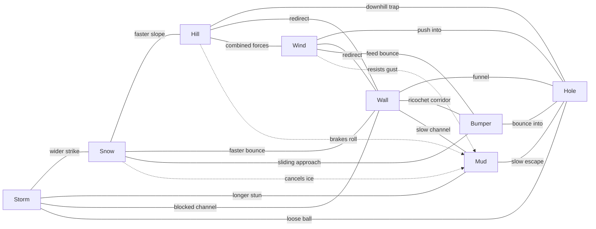

# SUNDAY — control the pitch, not the players

The football engine runs unchanged when no effect is active. Every new ability targets the ground. Eight effects form a graph of 21 pairwise connections; choose any three before kick-off (56 possible loadouts). No consumable charges: each equipped effect is reusable after its active lifetime plus a short recovery. Only one instance of each effect is allowed, preventing unlimited wall/hole spam. Durations use fixed simulation seconds; the native 1.5× playback displays real-time countdowns. Targeting freezes the game. No direct player-size, speed or shooting upgrades in the native game.

## Effects

| Effect | Duration / recovery (simulation seconds) | Core mechanic |
|---|---:|---|
| Storm | 7 / 5 | Cloud pulses every 2.4s after a warning, stuns blue outfield players for 1.8s, dislodges carried ball |
| Snow | 10 / 4 | Local momentum carry makes both teams overshoot turns, low ball retains speed |
| Hole | 10 / 5 | Removes low balls and outfield players temporarily, safe respawn |
| Hill | 10 / 4 | Radial downhill force on loose ball, uphill runners slowed |
| Wall | 8 / 5 | Fixed cross-pitch barrier with swept ball crossing detection and player blocking |
| Wind | 8 / 4 | Local gust moves low loose balls toward the home attacking end |
| Mud | 10 / 4 | Both teams slowed, ground ball loses momentum |
| Bumper | 10 / 4 | Two physical posts, rebounds and obstruction |

## Synergy graph

The authoritative machine-readable graph is ENVIRONMENT_GRAPH in scripts/engine-evaluation/mutations.js.

Amplification and counter edges are implemented as changes to the physical interaction, with counters taking precedence where specified. Setup edges are spatial opportunities, not guaranteed outcomes or invisible damage bonuses. The graph does not promise every pair is equally effective.

## Example loadouts

- Storm / Snow / Hole: freeze a channel, stun the blue runner, let the loose ball slide into a trap.
- Hill / Wind / Wall: steer loose balls into attacking spaces using slope and rebound.
- Wall / Bumper / Hole: arrange a ricochet corridor and trap.
- Mud / Storm / Wall: defend a vulnerable area, stop the runner and slow the loose ball.
- Snow / Hill / Bumper: more chaotic high-momentum football.

## Test and balance

Unit tests verify graph connectivity, three-slot restrictions, cooldown/reuse, storm, snow, hill, wind, mud and wall mechanics; native simulation tests cover eight representative three-effect loadouts through complete matches. These are mechanics and stability tests, not proof of balance. Next measure win rate, meaningful deployments per match, actual edge utilisation and whether opponent movement/path planning recognises hazards. Current prototype is local-zone geometry rather than a full 3D terrain simulation; walls are fixed orientation. Original legacy match lab remains available for comparison; it is not the native playable game.
